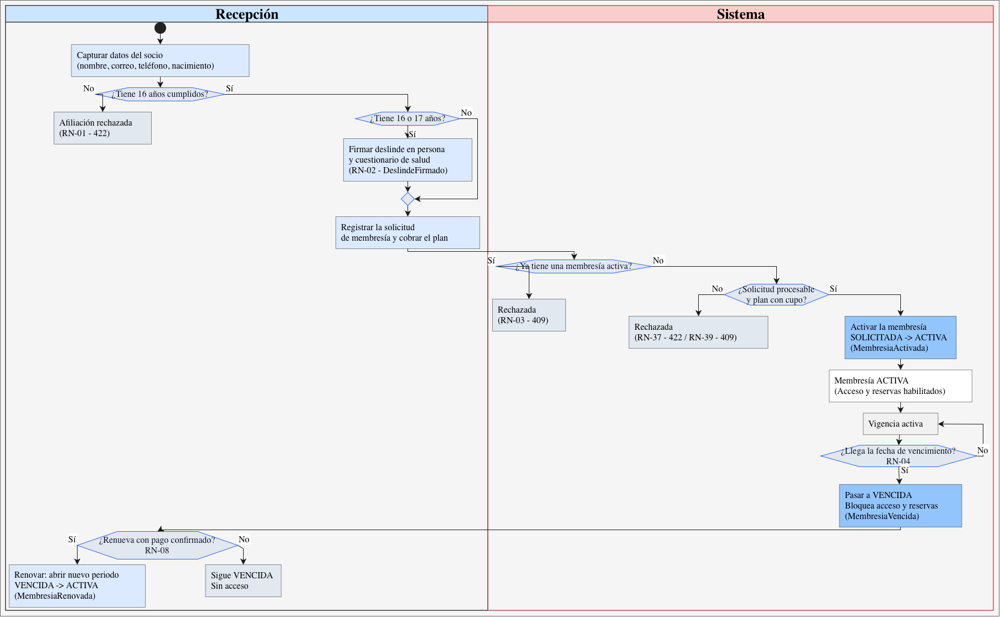
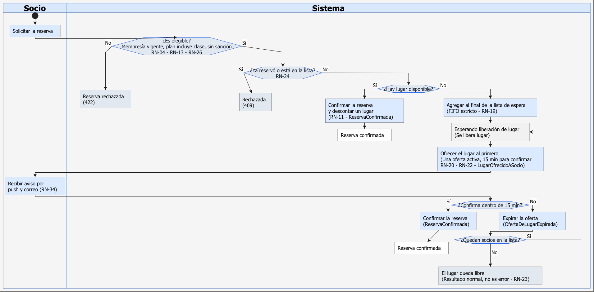
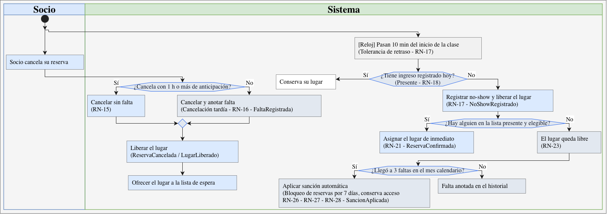
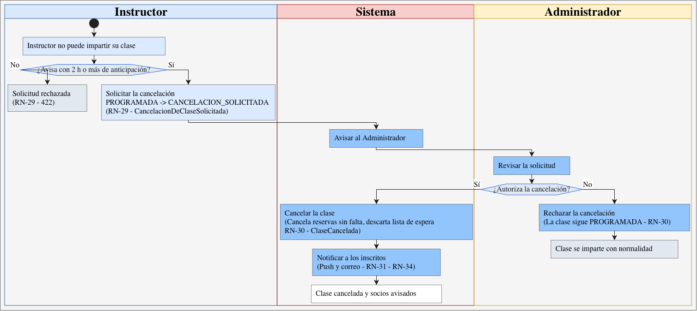
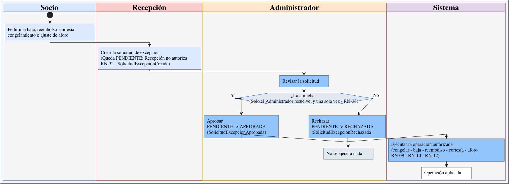
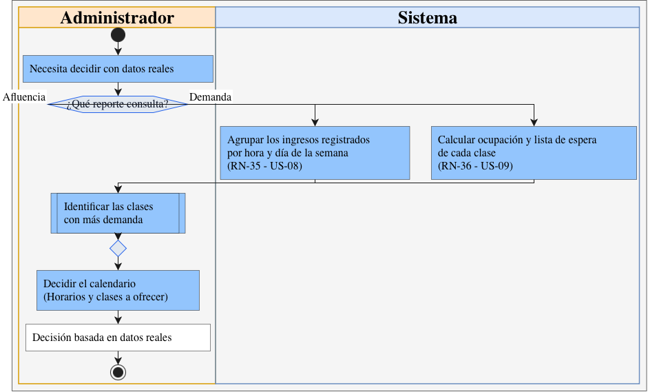

# BRD · FitZone

**Business Requirements Document refinado para el PIA** · Componentes de Lógica de Negocios · FIME-UANL

| | |
|---|---|
| **Equipo** | 11 |
| **Integrantes** | Josue Rodrigo Silva Fraga (2153436) · Jesús Emmanuel Camacho Moreno (2153842) · Valentín Monsivais Martínez (2157656) |
| **Profesor** | Miguel Ángel Gómez Marroquín |
| **Empresa / caso** | FitZone (gimnasio: membresías, acceso y reservas de clases grupales) |
| **Base** | BRD de la Unidad 2, refinado con el diseño arquitectural de la Unidad 3 (ver [Anexo B](#anexo-b-cambios-respecto-a-la-versión-de-la-unidad-2)) |

Este documento reúne el **análisis** del negocio: contexto, necesidades, reglas numeradas (RN-01 a RN-41), 22 historias de usuario con criterios de aceptación en Gherkin, procesos BPMN y glosario. Las reglas llevan identificador estable para poder trazarlas hasta el código y las pruebas.

## Documentos relacionados (`docs/architecture/`)

El diseño que se deriva de este análisis vive en la carpeta de arquitectura:

- [Modelo de dominio](architecture/modelo-dominio.md): aggregates, Value Objects, servicios y eventos de dominio.
- [Ciclos de vida](architecture/ciclos-de-vida.md): tablas de estados y transiciones (State Machine).
- [Diferencias con el paquete del PIA](architecture/diferencias-paquete-pia.md): equivalencias entre el paquete de datos y FitZone.
- [Matriz de trazabilidad](architecture/trazabilidad.md): historia → regla → componente → prueba.
- ADR-001 (patrón de lógica de negocio), ADR-002 (lista de espera automática) y ADR-003 (sanción por no-show), citados en la columna «Origen» de las reglas.
- [ADR-008](architecture/adr/ADR-008-alcance-del-codigo.md): qué parte de este análisis está programada. El alcance de esta sección 5 es el del negocio; el código cubre las membresías, las reservas, la lista de espera y las sanciones.

## Contenido

1. [Contexto](#1-contexto)
2. [Operación actual (AS-IS)](#2-operación-actual-as-is)
3. [Problema / oportunidad](#3-problema--oportunidad)
4. [Stakeholders](#4-stakeholders)
5. [Alcance](#5-alcance)
6. [Necesidades](#6-necesidades)
7. [Reglas de negocio](#7-reglas-de-negocio)
8. [Supuestos](#8-supuestos)
9. [Criterios de éxito](#9-criterios-de-éxito)
10. [Historias de usuario](#10-historias-de-usuario)
11. [Criterios de aceptación (Gherkin)](#11-criterios-de-aceptación-gherkin)
12. [Procesos de negocio (BPMN)](#12-procesos-de-negocio-bpmn)
13. [Glosario](#13-glosario)
- [Anexo A. Levantamiento (entrevista al stakeholder)](#anexo-a-levantamiento-entrevista-al-stakeholder)
- [Anexo B. Cambios respecto a la versión de la Unidad 2](#anexo-b-cambios-respecto-a-la-versión-de-la-unidad-2)

---

## 1. Contexto

FitZone es un gimnasio cuyo modelo de negocio se basa en la venta de membresías mensuales, trimestrales y anuales, complementadas con clases especiales y sesiones de entrenamiento personal. El proceso central gira en torno a la gestión de membresías, el control de accesos y la reservación de clases grupales, que tienen instructor, horario y capacidad máxima definida por el salón y el equipamiento. La lista de espera, el aviso de cancelaciones y el registro de asistencia se llevan hoy de forma manual, lo que genera inconsistencias y dificulta medir el desempeño del negocio.

## 2. Operación actual (AS-IS)

Cada socio tiene una membresía con fecha de inicio y de vencimiento, y se identifica en recepción para ingresar. Puede reservar un lugar en una clase grupal; si está llena, se maneja una lista de espera, y cuando alguien cancela, el lugar liberado puede asignarse a otro socio. La lista de espera, el aviso de cancelaciones y el control de asistencia son manuales, lo que origina los problemas de la sección 3.

## 3. Problema / oportunidad

Los dos problemas prioritarios son las ausencias no notificadas (no-shows) y la gestión manual de la lista de espera: dejan lugares vacíos que otros socios podrían usar y generan descontento inmediato. De forma secundaria, el control de accesos es inconsistente según el tipo de membresía y no existe un mecanismo formal para medir la demanda de cada clase. Automatizar estos procesos permite decidir con datos reales y aprovechar la capacidad instalada.

## 4. Stakeholders

| ROL | RESPONSABILIDADES Y AUTORIDAD | FUENTE |
|---|---|---|
| SOCIO | Adquiere membresía, reserva clases, se identifica en recepción, solicita cambios de plan (upgrade en cualquier momento) y cancela reservas dentro del límite permitido | P1, P3, P11 |
| RECEPCIÓN | Da de alta socios y registra cobros iniciales; identifica a los socios al ingreso. Ya no gestiona la lista de espera (la automatiza el sistema). No puede dar bajas, cancelar contratos, procesar devoluciones ni autorizar excepciones: solo crea la solicitud | P1, P4, P5 |
| INSTRUCTOR | Imparte las clases; puede solicitar la cancelación de una clase con al menos 2 horas de aviso, pero no autorizarla | P6 |
| ADMINISTRADOR | Autoriza bajas definitivas, reembolsos, cortesías o pases temporales, congelamientos por causa médica y ajustes de aforo; aprueba o rechaza la cancelación formal de clases. No autoriza sanciones por no-show: son automáticas | P4, P6, P7 |
| SISTEMA (RELOJ) | Ejecuta lo que dispara el tiempo: tolerancia de retraso (10 min), expiración de ofertas (15 min), vencimiento de membresías y envío de notificaciones | P12, P15 |

## 5. Alcance

### 5.1 Dentro

- Gestión de membresías: alta, vigencia, renovación, cambios de plan, congelamiento y baja, con su ciclo de vida por estados.
- Control de acceso por número de socio, con registro de cada ingreso.
- Reservación de clases con lista de espera automática y asignación de lugares liberados.
- Excepciones operativas: no-shows, cancelaciones tardías, cancelación de clases por el instructor y tolerancia de retraso.

- Historial y datos operativos: asistencia, faltas, sanciones, marcajes de entrada y demanda por clase.
- Notificaciones automatizadas por push y correo.
- Solicitudes de excepción que autoriza el Administrador (bajas, reembolsos, cortesías, congelamientos y ajustes de aforo).
- Contratación de membresías por solicitud (módulo del paquete de pruebas del PIA; ver [diferencias con el paquete del PIA](architecture/diferencias-paquete-pia.md)).

### 5.2 Fuera

- Gestión y programación del entrenamiento personal.
- Procesos contables o fiscales más allá del registro de pagos de membresía.
- Inventario y mantenimiento del equipamiento.
- Programas de fidelización, promociones y marketing dirigido. Las cortesías o pases temporales que autoriza el Administrador sí están dentro; el beneficio de referencia (BN-10) es una regla ilustrativa del paquete del PIA (ver [diferencias con el paquete del PIA](architecture/diferencias-paquete-pia.md)).

## 6. Necesidades

| ID | NECESIDAD | ORIGEN |
|---|---|---|
| BN-01 | Automatizar la lista de espera: notificar al socio correspondiente y darle un lapso definido para confirmar antes de pasar al siguiente, o asignar de inmediato al presente cuando el lugar se libera por retraso | P5, P12, P15 |
| BN-02 | Controlar los no-shows con una sanción automática (bloqueo temporal de reservas) para quien acumule faltas | P10, P11 |
| BN-03 | Estandarizar el aviso de cancelación de clases con notificaciones automáticas (push y correo), sin canales informales | P6, P16 |
| BN-04 | Registrar los marcajes de entrada para generar reportes de tráfico por hora y día | P17 |
| BN-05 | Medir formalmente la demanda de cada clase (ocupación y lista de espera) | P18 |
| BN-06 | Diferenciar en la oferta las clases incluidas en la membresía estándar de las de costo adicional o exclusivas del plan Premium | P13 |
| BN-07 | Exigir deslinde de responsabilidad y cuestionario de salud a socios de 16 y 17 años | P9 |
| BN-08 | Impedir que Recepción autorice bajas, cancelaciones de contrato, reembolsos y otras excepciones sensibles; se canalizan al Administrador | P4, P7 |
| BN-09 | Controlar el ciclo de vida de la membresía (solicitud, activación, congelamiento, vencimiento, renovación y baja) y el cupo de cada plan | P2, P3, P7, Paquete PIA |
| BN-10 | Identificar el beneficio de referencia para socios Premium con solicitudes altas y sin cortesía activa (regla ilustrativa del paquete; no proviene de la entrevista) | Paquete PIA |

## 7. Reglas de negocio

Las reglas tienen identificador estable (RN-xx) para trazar cada una hasta el código y las pruebas. Los límites de tiempo (1 h, 2 h, 10 min, 15 min, 3 faltas, 7 días) son parámetros configurables. P7 incluía las sanciones entre lo que autoriza el Administrador; se resuelve a favor de P10, BN-02 y US-06 (sanción automática).

### 7.1 Membresía y acceso

| ID | REGLA | ORIGEN |
|---|---|---|
| RN-01 | Edad mínima de 16 años cumplidos; los menores de 16 se rechazan | P9, US-15 |
| RN-02 | Con 16 o 17 años se exige deslinde firmado presencialmente y cuestionario de salud antes de activar la membresía | P9, BN-07, US-11 |
| RN-03 | Un socio solo puede tener una membresía activa; activar otra se rechaza por conflicto (409) | ADR-001, Act3 |
| RN-04 | La membresía está vigente si hoy es anterior a la fecha de vencimiento; el día de vencimiento ya bloquea acceso y reservas, sin periodo de gracia | P2 |
| RN-05 | El acceso se autoriza por número de socio solo con membresía vigente, y cada ingreso se registra | P1, P2, P17, US-02 |
| RN-06 | El upgrade se permite en cualquier momento pagando la diferencia proporcional | P3, US-13 |
| RN-07 | Downgrade o cancelación anticipada: sin reembolso en efectivo; queda saldo a favor | P3 |
| RN-08 | Renovar, con pago confirmado, abre un nuevo periodo; así se reactiva una membresía vencida | BRD 5.1 |
| RN-09 | Congelar por causa médica solo procede con solicitud aprobada por el Administrador; es temporal y reversible | P7 |
| RN-10 | La baja definitiva solo procede con solicitud aprobada por el Administrador | P4, P7, BN-08 |

### 7.2 Reservas y clases

| ID | REGLA | ORIGEN |
|---|---|---|
| RN-11 | La capacidad es fija por salón y equipamiento, independiente de instructor y horario; las reservas confirmadas no la superan | P8 |
| RN-12 | El ajuste de aforo se hace solo con solicitud aprobada por el Administrador y no puede bajar de las reservas ya confirmadas | P7 |
| RN-13 | Reservar exige membresía vigente, plan que incluya la categoría de la clase y ausencia de sanción activa; si no hay cupo, el socio entra a la lista de espera | P2, P10, P13, US-01 |
| RN-14 | Las clases Estándar van incluidas en la membresía; las Premium o talleres tienen costo adicional y se marcan así en el catálogo | P13, BN-06, US-10 |
| RN-15 | Cancelar con 1 h o más de anticipación: sin falta y se libera el lugar | P11, US-14 |
| RN-16 | Cancelar con menos de 1 h: se libera el lugar y cuenta como falta (cancelación tardía) | P11, ADR-003 |
| RN-17 | Tolerancia de retraso de 10 min: con más de 10 min sin ingreso, el lugar se libera y se registra no-show al titular | P12 |
| RN-18 | “Presente” significa tener un ingreso registrado ese día | ADR-002 |

### 7.3 Lista de espera

| ID | REGLA | ORIGEN |
|---|---|---|
| RN-19 | El orden es FIFO estricto, por orden de registro | P15, US-05 |
| RN-20 | Lugar liberado por cancelación: se ofrece al primero con 15 min para confirmar (a los 15 exactos aún se acepta); si no confirma, pasa al siguiente | P15, BN-01, US-04 |
| RN-21 | Lugar liberado por retraso: se asigna de inmediato al primero de la lista que esté presente y siga elegible | P12, ADR-002 |
| RN-22 | Solo hay una oferta activa por clase | Act3 |
| RN-23 | Si la lista se agota o nadie está presente, el lugar queda libre; es un resultado normal, no un error | ADR-002 |
| RN-24 | Un socio no puede estar dos veces en la lista de espera de la misma clase | Act5 |

### 7.4 No-show y sanciones

| ID | REGLA | ORIGEN |
|---|---|---|
| RN-25 | Es falta no asistir sin cancelar a tiempo, o cancelar con menos de 1 h | P10, P11 |
| RN-26 | Con 3 faltas en un mismo mes calendario, el socio no puede reservar durante 7 días naturales, pero conserva el acceso al gimnasio | P10, BN-02, US-06 |
| RN-27 | La sanción es automática, sin autorización del Administrador | ADR-003 |
| RN-28 | Al aplicarse la sanción, esas 3 faltas se consumen (siguen en el historial) y una sanción activa no se extiende | Aclaración del BRD |

### 7.5 Cancelación de clase y excepciones

| ID | REGLA | ORIGEN |
|---|---|---|
| RN-29 | El instructor solo puede solicitar la cancelación de su clase, con 2 h o más de aviso; con menos se rechaza | P6 |
| RN-30 | Solo el Administrador la aprueba o rechaza; al aprobarse se cancelan las reservas sin falta y se descarta la lista de espera; al rechazarse, la clase sigue programada | P6, P7 |
| RN-31 | Aprobada la cancelación, se notifica por push y correo a todos los inscritos | P16, BN-03, US-07 |
| RN-32 | Recepción da de alta y cobra, pero no puede dar bajas, reembolsos ni excepciones: las crea como solicitud pendiente | P4, BN-08, US-12 |
| RN-33 | Solo el Administrador aprueba o rechaza cortesías, congelamientos, bajas, reembolsos y ajustes de aforo; una solicitud no se resuelve dos veces | P7, BN-08 |

### 7.6 Notificaciones y reportes

| ID | REGLA | ORIGEN |
|---|---|---|
| RN-34 | Toda notificación sale por push y correo mediante un puerto Notificador | P16 |
| RN-35 | Los ingresos registrados alimentan el reporte de afluencia por hora y día de la semana | P17, BN-04, US-08 |
| RN-36 | El reporte de demanda por clase muestra ocupación y lista de espera | P18, BN-05, US-09 |

### 7.7 Contratación de membresías (paquete del PIA)

| ID | REGLA | ORIGEN |
|---|---|---|
| RN-37 | Una solicitud es procesable si el socio está activo, tiene al menos una línea y está validada | Paquete PIA |
| RN-38 | El total es Σ precio × cantidad, con Decimal; la cantidad es un entero de 1 o más y el plan debe estar habilitado | Paquete PIA |
| RN-39 | Activar una solicitud exige cupo disponible en el plan | Paquete PIA |
| RN-40 | Beneficio de referencia: socio Premium con total de 1500 MXN o más y sin cortesía activa. Es una regla ilustrativa del paquete, no de la entrevista | Paquete PIA |
| RN-41 | Estados SOLICITADA → ACTIVA → SUSPENDIDA → VENCIDA, más CANCELADA; saltar un estado o repetir una aprobación se rechaza por conflicto (409) | Paquete PIA, RN-09 |

## 8. Supuestos

- Todos los socios tienen un correo o dispositivo móvil registrado y funcional para recibir notificaciones.
- Hay conectividad estable en las instalaciones para registrar marcajes de entrada en tiempo real.
- El número de socio o código sigue siendo el mecanismo de identificación en recepción.
- Recepción y Administrador recibirán capacitación para los nuevos módulos.
- Los registros históricos en papel no se migran.
- Las reglas confirmadas en la entrevista siguen vigentes durante el proyecto, salvo indicación del Administrador.
- La presencia en clase se determina por el ingreso registrado al gimnasio; el BRD no define asistencia dentro del salón (mejora futura).
- Los planes oficiales son mensual, trimestral y anual. La duración de un plan es un valor en meses, por lo que otros planes pueden existir como dato sin cambiar el diseño.
- En la contratación de membresías, la cantidad de una línea son los periodos contratados y el importe es precio x cantidad.
- El plan de un socio es Premium si el socio está marcado como Premium. Un socio Standard no reserva clases Premium; el cobro del costo adicional (RN-14) queda como mejora futura.
- Con la clase iniciada ya no se reserva ni se cancela, y tampoco se hacen ofertas nuevas: desde ese momento los lugares solo se asignan por retraso (RN-21).
- Un lugar ofrecido queda apartado hasta que la oferta se resuelva, y quien reserva mientras hay socios esperando entra a la lista aunque quede un lugar libre (RN-19).
- Confirmar una oferta vuelve a exigir la elegibilidad de RN-13.
- Las faltas que ocurren durante una sanción activa no la extienden (RN-28), pero cuentan para la siguiente si son del mismo mes calendario.
- La hora del negocio es la local de Monterrey. La fecha de una falta es la hora de inicio de la clase.

## 9. Criterios de éxito

- Elevar la tasa de asistencia efectiva a clases reservadas a más del 90%, medida como ocupación real frente a reservas efectuadas.
- Reducir las ausencias no notificadas (no-shows) a menos del 5% mensual.
- Contar con un registro estructurado de tráfico y demanda por clase que sustituya el registro en papel.
- Estandarizar el 100% de los avisos de cancelación de clases mediante notificación automatizada.

## 10. Historias de usuario

Son 22 historias. Las US-01 a US-15 vienen de la Unidad 2 y las US-16 a US-22 son nuevas. Cada una tiene criterios de aceptación en Gherkin (sección 11), etiquetados con las reglas que verifican.

| ID | ROL | QUIERO… | PARA… | BN |
|---|---|---|---|---|
| US-01 | Socio | reservar un lugar en una clase grupal | asegurar mi espacio antes de que se llene | AS-IS |
| US-02 | Socio | identificarme en recepción con mi número de socio | poder ingresar a las instalaciones | AS-IS |
| US-03 | Socio | consultar la fecha de vencimiento de mi membresía | saber si sigue activa y anticipar mi renovación | AS-IS |
| US-04 | Socio | ser notificado automáticamente cuando se libere un lugar en la lista de espera | confirmar mi asistencia a tiempo sin depender de una llamada manual | BN-01 |
| US-05 | Recepción | que el sistema asigne el lugar liberado al siguiente socio de la lista (FIFO) | evitar gestionar manualmente el orden de espera | BN-01 |
| US-06 | Administrador | que el sistema bloquee las reservas de un socio con 3 faltas en el mes | aplicar la sanción de no-show sin intervención manual | BN-02 |
| US-07 | Socio | recibir una notificación push o por correo cuando cancelen mi clase | enterarme a tiempo sin depender de WhatsApp o avisos informales | BN-03 |
| US-08 | Administrador | consultar reportes de tráfico de entrada por hora y día | identificar los horarios de mayor afluencia | BN-04 |
| US-09 | Administrador | consultar la demanda (ocupación y lista de espera) de cada clase | decidir si abrir nuevos horarios con datos reales | BN-05 |
| US-10 | Socio | distinguir qué clases están incluidas en mi plan y cuáles tienen costo adicional | evitar confusión al reservar | BN-06 |
| US-11 | Recepción | que el sistema exija el deslinde firmado al afiliar a un socio de 16 o 17 años | cumplir el requisito legal antes de activar su membresía | BN-07 |
| US-12 | Recepción | que el sistema me impida procesar bajas, reembolsos o cancelaciones de contrato | canalizar esas solicitudes al Administrador | BN-08 |
| US-13 | Socio | cambiar mi plan a la mitad del periodo (upgrade o downgrade) | ajustar mi membresía a mis necesidades | AS-IS |
| US-14 | Socio | cancelar mi reserva con al menos 1 hora de anticipación | liberar el lugar sin que se me marque como no-show | BN-02 |
| US-15 | Recepción | dar de alta a un nuevo socio en el sistema | iniciar su membresía y habilitar su acceso | AS-IS |
| US-16 | Socio | renovar mi membresía | conservar mi acceso y mis reservas | AS-IS |
| US-17 | Administrador | aprobar o rechazar las solicitudes de excepción | controlar bajas, congelamientos, reembolsos, cortesías y ajustes de aforo | BN-08 |
| US-18 | Instructor | solicitar la cancelación de una clase con al menos 2 horas de aviso | avisar cuando no puedo impartirla | BN-03 |
| US-19 | Socio en lista de espera | que se me asigne de inmediato el lugar de quien llega más de 10 minutos tarde, si estoy presente | no perder la clase por un lugar vacío | BN-01 |
| US-20 | Socio en lista de espera | 15 minutos para confirmar mi lugar antes de que pase al siguiente | no perderlo de inmediato | BN-01 |
| US-21 | Recepción | activar la solicitud ya validada de un socio | habilitar su acceso | BN-09 |
| US-22 | Administrador | identificar a los socios Premium con solicitudes altas y sin cortesía activa | otorgarles el beneficio de referencia | BN-10 |

## 11. Criterios de aceptación (Gherkin)

Todo el Gherkin está en español. Cada escenario lleva etiquetas @RN-xx con las reglas que verifica, y cubre el caso normal, los errores y los valores límite.

### US-01 · Reservar una clase grupal

```gherkin
# language: es
Característica: Reservar una clase grupal
  Como socio quiero reservar un lugar en una clase para asegurar mi espacio antes de que se llene

  @RN-11 @RN-13
  Escenario: Reservar con lugares disponibles
    Dado un socio con membresía vigente, plan que incluye la categoría de la clase y sin sanción activa
    Y una clase con lugares disponibles
    Cuando el socio reserva
    Entonces la reserva queda confirmada y se descuenta un lugar

  @RN-13 @RN-19
  Escenario: Clase llena
    Dado una clase sin lugares disponibles
    Cuando un socio elegible reserva
    Entonces queda al final de la lista de espera de la clase

  @RN-04 @RN-13 @RN-26
  Esquema del escenario: Socio no elegible
    Dado un socio con <situación>
    Cuando intenta reservar una clase con lugares disponibles
    Entonces el sistema rechaza la reserva
    Ejemplos:
      | situación |
      | membresía vencida |
      | sanción por no-show activa |
      | plan que no incluye la categoría de la clase |

  @RN-24
  Escenario: Socio ya en la lista de espera
    Dado una clase llena y un socio que ya está en su lista de espera
    Cuando intenta reservar de nuevo
    Entonces el sistema rechaza la solicitud
```

### US-02 · Identificarse en recepción

```gherkin
Característica: Identificarse en recepción
  Como socio quiero identificarme con mi número de socio para ingresar a las instalaciones

  @RN-05
  Escenario: Ingreso con membresía vigente
    Dado un socio con membresía vigente
    Cuando Recepción captura su número de socio
    Entonces el sistema autoriza el ingreso y registra el marcaje de entrada

  @RN-04
  Escenario: Membresía que vence hoy
    Dado un socio cuya membresía vence hoy
    Cuando Recepción captura su número de socio
    Entonces el sistema niega el ingreso, sin periodo de gracia

  @RN-05
  Escenario: Número de socio inexistente
    Cuando Recepción captura un número de socio que no existe
    Entonces el sistema responde que el socio no fue encontrado
```

### US-03 · Consultar el vencimiento de la membresía

```gherkin
Característica: Consultar el vencimiento de la membresía
  Como socio quiero consultar la fecha de vencimiento para anticipar mi renovación

  @RN-04
  Escenario: Membresía vigente
    Dado un socio con membresía vigente
    Cuando consulta su cuenta
    Entonces el sistema muestra el plan, la fecha de inicio, la fecha exacta de vencimiento y su estado

  @RN-04
  Escenario: Membresía vencida
    Dado un socio con membresía vencida
    Cuando consulta su cuenta
    Entonces el estado es VENCIDA y se indica que debe renovar para recuperar el acceso
```

### US-04 · Notificación de lugar disponible

```gherkin
Característica: Notificación de lugar disponible
  Como socio en lista de espera quiero ser notificado cuando se libere un lugar para confirmar a tiempo

  @RN-20 @RN-34
  Escenario: Lugar liberado por cancelación con lista de espera
    Dado una clase llena con lista de espera
    Cuando un socio cancela su reserva con anticipación
    Entonces el sistema ofrece el lugar al primer socio de la lista
    Y le notifica por push y correo que tiene 15 minutos para confirmar

  @RN-23
  Escenario: Lugar liberado sin lista de espera
    Dado una clase llena sin lista de espera
    Cuando un socio cancela su reserva
    Entonces el lugar queda disponible para reservar
```

### US-05 · Asignación en orden FIFO

```gherkin
Característica: Asignación en orden FIFO
  Como Recepción quiero que el sistema asigne el lugar liberado al siguiente de la lista sin gestionarlo a mano

  @RN-19
  Escenario: Se ofrece al primero de la lista
    Dado una lista de espera con los socios A y B, en ese orden
    Cuando se libera un lugar por cancelación
    Entonces la oferta es para A y B sigue esperando

  @RN-19
  Escenario: El orden depende solo del registro
    Dado que B tiene un plan Premium y A un plan Standard, y A se registró primero
    Cuando se libera un lugar por cancelación
    Entonces la oferta es para A

  @RN-24
  Escenario: Registro duplicado en la lista
    Dado un socio que ya está en la lista de espera de una clase
    Cuando intenta registrarse otra vez en esa lista
    Entonces el sistema rechaza el registro y conserva su posición original
```

### US-06 · Sanción automática por no-show

```gherkin
Característica: Sanción automática por no-show
  Como Administrador quiero que el sistema bloquee las reservas tras 3 faltas en el mes sin intervención manual

  @RN-26 @RN-27
  Escenario: Tercera falta del mes
    Dado un socio con 2 faltas en el mes calendario
    Cuando se registra su tercera falta
    Entonces el sistema le bloquea nuevas reservas durante 7 días naturales
    Y conserva su acceso general al gimnasio
    Y no se requiere autorización del Administrador

  @RN-26
  Escenario: Solo dos faltas en el mes
    Dado un socio con 1 falta en el mes calendario
    Cuando se registra su segunda falta
    Entonces no se aplica sanción

  @RN-26
  Escenario: Faltas de meses distintos
    Dado un socio con 2 faltas en el mes anterior
    Cuando se registra una falta en el mes actual
    Entonces no se aplica sanción

  @RN-28
  Escenario: Las faltas sancionadas se consumen
    Dado un socio sancionado por sus 3 faltas del mes
    Cuando se registra una nueva falta en el mismo mes
    Entonces cuenta como la primera falta de un nuevo ciclo
    Y la sanción activa no se extiende
```

### US-07 · Aviso de cancelación de clase

```gherkin
Característica: Aviso de cancelación de clase
  Como socio quiero recibir un aviso cuando cancelen mi clase para enterarme a tiempo

  @RN-30 @RN-31
  Escenario: Cancelación aprobada con socios inscritos
    Dado una clase en CANCELACION_SOLICITADA con socios inscritos
    Cuando el Administrador aprueba la cancelación
    Entonces la clase pasa a CANCELADA
    Y se notifica por push y correo a todos los inscritos
    Y sus reservas se cancelan sin registrar falta
    Y se descarta la lista de espera

  @RN-31
  Escenario: Cancelación aprobada sin inscritos
    Dado una clase en CANCELACION_SOLICITADA sin socios inscritos
    Cuando el Administrador aprueba la cancelación
    Entonces la clase pasa a CANCELADA y no se envían notificaciones
```

### US-08 · Reporte de afluencia

```gherkin
Característica: Reporte de afluencia
  Como Administrador quiero ver el tráfico de entrada por hora y día para identificar horarios de mayor afluencia

  @RN-35
  Escenario: Afluencia por hora y día de la semana
    Dado marcajes de entrada registrados
    Cuando el Administrador solicita el reporte de un rango de fechas
    Entonces el sistema muestra el total de ingresos por hora y por día de la semana

  @RN-35
  Escenario: Rango sin ingresos
    Dado un rango de fechas sin marcajes
    Cuando el Administrador solicita el reporte
    Entonces el sistema muestra el reporte con totales en cero

  @RN-35
  Escenario: Rango inválido
    Cuando el Administrador solicita un reporte con fecha final anterior a la inicial
    Entonces el sistema rechaza la consulta por datos inválidos
```

### US-09 · Reporte de demanda por clase

```gherkin
Característica: Reporte de demanda por clase
  Como Administrador quiero ver la ocupación y la lista de espera de cada clase para decidir nuevos horarios

  @RN-36
  Escenario: Clase llena con lista de espera
    Dado una clase con 20 de 20 lugares reservados y 3 socios en lista de espera
    Cuando el Administrador consulta el reporte de demanda
    Entonces la ocupación es 100% y se muestran 3 personas en lista de espera

  @RN-36
  Escenario: Clase sin reservas
    Dado una clase sin reservas
    Cuando el Administrador consulta el reporte de demanda
    Entonces la ocupación es 0% y no hay personas en lista de espera
```

### US-10 · Catálogo de clases con etiquetas

```gherkin
Característica: Catálogo de clases con etiquetas
  Como socio quiero distinguir qué clases incluye mi plan para evitar confusión al reservar

  @RN-14
  Esquema del escenario: Etiqueta de la clase
    Dado un socio con plan <plan>
    Cuando consulta una clase de categoría <categoría>
    Entonces la clase se muestra como «<etiqueta>»
    Ejemplos:
      | plan | categoría | etiqueta |
      | Standard | Estándar | Incluida en tu membresía |
      | Standard | Premium | Costo adicional / Exclusiva Plan Premium |
      | Premium | Premium | Incluida en tu membresía |
```

### US-11 · Deslinde para menores de edad

```gherkin
Característica: Deslinde para menores de edad
  Como Recepción quiero que el sistema exija el deslinde firmado a socios de 16 y 17 años antes de activar su membresía

  @RN-01 @RN-02
  Esquema del escenario: Activación según la edad
    Dado un aspirante de <edad> años <documentación>
    Cuando Recepción intenta activar su membresía
    Entonces <resultado>
    Ejemplos:
      | edad | documentación | resultado
      |
      | 15 | sin deslinde | el sistema rechaza el alta por edad mínima |
      | 16 | sin deslinde ni cuestionario de salud | el sistema exige el deslinde y no activa |
      | 17 | con deslinde y cuestionario de salud | la membresía se activa |
      | 18 | sin deslinde | la membresía se activa |
```

### US-12 · Operaciones sensibles solo para el administrador

```gherkin
Característica: Operaciones sensibles solo para el Administrador
  Como Recepción quiero que el sistema canalice bajas y reembolsos al Administrador para no excederme en mi autoridad

  @RN-32
  Esquema del escenario: Recepción intenta una operación sensible
    Dado un empleado con rol Recepción
    Cuando intenta procesar <operación>
    Entonces el sistema no la ejecuta y crea una solicitud PENDIENTE para el Administrador
    Ejemplos:
      | operación |
      | una baja definitiva |
      | una cancelación de contrato |
      | un reembolso |

  @RN-32
  Escenario: Recepción realiza un alta y un cobro inicial
    Dado un empleado con rol Recepción
    Cuando registra el alta de un socio y su cobro inicial
    Entonces el sistema lo permite sin solicitud al Administrador
```

### US-13 · Cambio de plan a mitad del periodo

```gherkin
Característica: Cambio de plan a mitad del periodo
  Como socio quiero cambiar mi plan para ajustar mi membresía a mis necesidades

  @RN-06
  Escenario: Upgrade
    Dado un socio con membresía ACTIVA en un plan menor
    Cuando solicita cambiar a un plan de mayor categoría
    Entonces el sistema calcula la diferencia proporcional a pagar
    Y aplica el cambio al confirmarse el pago

  @RN-07
  Escenario: Downgrade
    Dado un socio con membresía ACTIVA en un plan mayor
    Cuando solicita cambiar a un plan menor
    Entonces el cambio se aplica y el excedente queda como saldo a favor, sin reembolso en efectivo

  @RN-04
  Escenario: Membresía vencida
    Dado un socio con membresía VENCIDA
    Cuando solicita cambiar de plan
    Entonces el sistema rechaza el cambio y le indica que debe renovar
```

### US-14 · Cancelar una reserva

```gherkin
Característica: Cancelar una reserva
  Como socio quiero cancelar mi reserva con anticipación para liberar el lugar sin que se me marque no-show

  @RN-15 @RN-16
  Esquema del escenario: Cancelación según la anticipación
    Dado una reserva confirmada de una clase que inicia en <anticipación>
    Cuando el socio cancela su reserva
    Entonces el lugar se libera y <resultado>
    Ejemplos:
      | anticipación | resultado |
      | 2 horas | no se registra falta |
      | 1 hora exacta | no se registra falta |
      | 59 minutos | se registra una falta |

  @RN-20
  Escenario: Hay lista de espera
    Dado una clase llena con lista de espera
    Cuando un socio cancela con anticipación
    Entonces el lugar se ofrece al primero de la lista
```

### US-15 · Alta de un nuevo socio

```gherkin
Característica: Alta de un nuevo socio
  Como Recepción quiero dar de alta a un socio para iniciar su membresía y habilitar su acceso

  @RN-01 @RN-03
  Escenario: Alta de una persona que cumple los requisitos
    Dado una persona de 18 años o más sin membresía activa
    Cuando Recepción registra su alta
    Entonces el sistema crea al socio con una membresía ACTIVA y vigente
    Y habilita su acceso a las instalaciones

  @RN-01
  Escenario: Menor de 16 años
    Dado una persona de 15 años
    Cuando Recepción registra su alta
    Entonces el sistema rechaza el alta

  @RN-03
  Escenario: Socio que ya tiene una membresía activa
    Dado un socio con una membresía ACTIVA
    Cuando Recepción intenta registrar otra membresía para él
    Entonces el sistema rechaza el alta por conflicto
```

### US-16 · Renovar la membresía

```gherkin
Característica: Renovar membresía
  Como socio quiero renovar mi membresía para conservar mi acceso y mis reservas

  @RN-08
  Escenario: Renovar una membresía vencida con pago confirmado
    Dado un socio con una membresía VENCIDA
    Cuando se confirma el pago de su renovación
    Entonces la membresía pasa a ACTIVA con un nuevo periodo de vigencia
    Y el socio recupera el acceso y la reserva de clases

  @RN-08 @RN-04
  Escenario: Renovar sin pago confirmado
    Dado un socio con una membresía VENCIDA
    Cuando intenta renovar sin pago confirmado
    Entonces el sistema rechaza la operación y la membresía sigue VENCIDA
```

### US-17 · Resolver solicitudes de excepción

```gherkin
Característica: Resolver solicitudes de excepción
  Como Administrador quiero aprobar o rechazar las solicitudes que Recepción no puede resolver para controlar bajas, congelamientos, reembolsos, cortesías y ajustes de aforo

  @RN-09 @RN-33
  Escenario: Aprobar un congelamiento
    Dado una solicitud PENDIENTE de congelar una membresía ACTIVA
    Cuando el Administrador la aprueba
    Entonces la solicitud queda APROBADA y la membresía pasa a SUSPENDIDA

  @RN-10 @RN-33
  Escenario: Aprobar una baja definitiva
    Dado una solicitud PENDIENTE de baja de una membresía ACTIVA
    Cuando el Administrador la aprueba
    Entonces la membresía pasa a CANCELADA

  @RN-33
  Escenario: Rechazar una solicitud
    Dado una solicitud PENDIENTE
    Cuando el Administrador la rechaza
    Entonces la solicitud queda RECHAZADA y la membresía no cambia

  @RN-32 @RN-33
  Escenario: Recepción intenta resolver una solicitud
    Dado una solicitud PENDIENTE
    Cuando un empleado con rol Recepción intenta aprobarla
    Entonces el sistema rechaza la acción y la solicitud sigue PENDIENTE

  @RN-33
  Escenario: Resolver una solicitud ya resuelta
    Dado una solicitud ya APROBADA
    Cuando el Administrador intenta rechazarla
    Entonces el sistema rechaza la operación por conflicto de estado
```

### US-18 · Solicitar la cancelación de una clase

```gherkin
Característica: Solicitar la cancelación de una clase
  Como Instructor quiero solicitar la cancelación de una clase para avisar cuando no puedo impartirla

  @RN-29
  Escenario: Solicitud con aviso suficiente
    Dado una clase PROGRAMADA que inicia en 3 horas
    Cuando el instructor asignado solicita cancelarla
    Entonces la clase pasa a CANCELACION_SOLICITADA y se avisa al Administrador

  @RN-29
  Escenario: Solicitud con exactamente 2 horas de aviso
    Dado una clase PROGRAMADA que inicia en 2 horas exactas
    Cuando el instructor asignado solicita cancelarla
    Entonces la solicitud se acepta

  @RN-29
  Escenario: Solicitud con menos de 2 horas de aviso
    Dado una clase PROGRAMADA que inicia en 90 minutos
    Cuando el instructor asignado solicita cancelarla
    Entonces el sistema la rechaza y la clase sigue PROGRAMADA

  @RN-29
  Escenario: Solicitud de otro instructor
    Dado una clase PROGRAMADA asignada a otro instructor
    Cuando un instructor distinto solicita cancelarla
    Entonces el sistema rechaza la solicitud

  @RN-30
  Escenario: El Administrador rechaza la cancelación
    Dado una clase en CANCELACION_SOLICITADA
    Cuando el Administrador rechaza la solicitud
    Entonces la clase vuelve a PROGRAMADA y no se notifica a los socios
```

### US-19 · Asignar un lugar liberado por retraso

```gherkin
Característica: Asignar un lugar liberado por retraso
  Como socio en lista de espera quiero que se me asigne de inmediato el lugar de quien llega tarde

  @RN-17 @RN-21 @RN-25
  Escenario: Retraso mayor a 10 minutos con un socio presente en la lista
    Dado una clase que inició hace 11 minutos y un titular que no ha ingresado
    Y el primer socio de la lista tiene un ingreso registrado hoy
    Cuando el sistema aplica la tolerancia de retraso
    Entonces se registra una falta al titular
    Y el lugar se asigna de inmediato a ese socio

  @RN-17
  Escenario: Exactamente 10 minutos de retraso
    Dado una clase que inició hace 10 minutos y un titular que no ha ingresado
    Cuando el sistema aplica la tolerancia de retraso
    Entonces el lugar no se libera

  @RN-18 @RN-23
  Escenario: Ningún socio de la lista está presente
    Dado una clase que inició hace 12 minutos y nadie de la lista tiene ingreso registrado
    Cuando el sistema aplica la tolerancia de retraso
    Entonces se registra una falta al titular y el lugar queda libre
```

### US-20 · Expiración de la oferta de lugar

```gherkin
Característica: Expiración de la oferta de lugar
  Como socio en lista de espera quiero 15 minutos para confirmar mi lugar antes de que pase al siguiente

  @RN-20
  Escenario: Confirmar a los 15 minutos exactos
    Dado una oferta de lugar hecha hace 15 minutos
    Cuando el socio confirma su asistencia
    Entonces su reserva queda confirmada

  @RN-20 @RN-22
  Escenario: La oferta vence sin confirmar
    Dado una oferta hecha hace 16 minutos sin confirmar
    Cuando el sistema revisa las ofertas vencidas
    Entonces la oferta expira y el lugar se ofrece al siguiente socio en orden FIFO

  @RN-20 @RN-23
  Escenario: La oferta vence y no quedan socios en la lista
    Dado una oferta vencida y una lista de espera vacía
    Cuando el sistema revisa las ofertas vencidas
    Entonces el lugar queda libre

  @RN-20
  Escenario: Confirmar una oferta vencida
    Dado una oferta que ya expiró
    Cuando el socio intenta confirmar
    Entonces el sistema rechaza la confirmación
```

### US-21 · Activar una solicitud de membresía

```gherkin
Característica: Activar una solicitud de membresía
  Como Recepción quiero activar la solicitud ya validada de un socio para habilitar su acceso

  @RN-37 @RN-41
  Escenario: Activar una solicitud procesable
    Dado una solicitud SOLICITADA de un socio activo, con al menos una línea y validada
    Cuando Recepción la activa
    Entonces la solicitud pasa a ACTIVA

  @RN-37 @RN-38
  Esquema del escenario: Solicitud no procesable
    Dado una solicitud SOLICITADA que <condición>
    Cuando Recepción intenta activarla
    Entonces el sistema rechaza la activación
    Ejemplos:
      | condición |
      | no tiene líneas |
      | pertenece a un socio inactivo |
      | no está validada |
      | incluye un plan deshabilitado |

  @RN-03
  Escenario: Socio con otra membresía activa
    Dado un socio que ya tiene una membresía ACTIVA
    Cuando Recepción intenta activar otra solicitud
    Entonces el sistema rechaza la activación por conflicto

  @RN-39
  Escenario: Plan sin cupo
    Dado un plan que ya alcanzó su cupo de contratación
    Cuando Recepción intenta activar una solicitud de ese plan
    Entonces el sistema rechaza la activación

  @RN-41
  Escenario: Repetir la activación
    Dado una solicitud ya ACTIVA
    Cuando se intenta activar de nuevo
    Entonces el sistema rechaza la operación por conflicto de estado
```

### US-22 · Beneficio de referencia

```gherkin
Característica: Beneficio de referencia
  Como Administrador quiero identificar a los socios Premium con solicitudes altas y sin cortesía activa para otorgarles el beneficio de referencia

  @RN-40
  Esquema del escenario: Evaluar el beneficio
    Dado un socio <tipo> con una solicitud de <total> MXN y cortesía <cortesía>
    Cuando se evalúa el beneficio
    Entonces el beneficio es <resultado>
    Ejemplos:
      | tipo | total | cortesía | resultado |
      | Premium | 1500 | inactiva | otorgado |
      | Premium | 1499.99 | inactiva | denegado |
      | Premium | 2000 | activa | denegado |
      | Estándar | 2000 | inactiva | denegado |
```

## 12. Procesos de negocio (BPMN)

El BPMN está dibujado en draw.io con carriles (swimlanes) por actor: Socio, Recepción, Instructor, Administrador y Sistema. Las imágenes están en `docs/bpmn/`. Cubre estos procesos:

| PROCESO | CARRILES | DECISIONES CLAVE | REGLAS |
|---|---|---|---|
| Alta y vigencia de membresía | Recepción, Sistema | ¿Cumple la edad? ¿Tiene deslinde? ¿Ya tiene membresía activa? ¿La solicitud es procesable y hay cupo? ¿Renueva con pago? | RN-01 a RN-05, RN-08, RN-37, RN-39 |
| Reserva de clase y lista de espera | Socio, Sistema | ¿Es elegible? ¿Hay cupo? ¿Confirma en 15 min? | RN-04, RN-11, RN-13, RN-19 a RN-24, RN-26, RN-34 |
| Cancelación de reserva y no-show | Socio, Sistema | ¿Cancela con 1 h o más? ¿Está presente a los 10 min? ¿Llegó a 3 faltas? | RN-15 a RN-18, RN-21, RN-23, RN-25 a RN-28 |
| Cancelación de clase por el instructor | Instructor, Administrador, Sistema | ¿Hay 2 h de aviso? ¿Se autoriza? | RN-29 a RN-31, RN-34 |
| Solicitud de excepción | Socio, Recepción, Administrador, Sistema | ¿Se aprueba? | RN-09, RN-10, RN-12, RN-32, RN-33 |
| Consulta de reportes | Administrador, Sistema | ¿Qué reporte consulta? | RN-35, RN-36 |

**Cómo leer los diagramas.** Cada carril es un actor y las tareas se ubican en el carril de quien las ejecuta. Las reglas de negocio (RN-xx), el código HTTP del rechazo y el Domain Event que emite la tarea aparecen entre paréntesis dentro de la tarea.

| Elemento | Significado |
|---|---|
| Círculo negro | Evento de inicio |
| Círculo con borde doble | Evento de fin |
| Rectángulo | Tarea (azul claro: la ejecuta una persona; azul fuerte: la ejecuta el Sistema; gris: resultado de rechazo o estado final) |
| Rectángulo blanco | Estado resultante (por ejemplo, «Reserva confirmada») |
| Hexágono con **Sí / No** | Compuerta exclusiva (decisión) |
| Rombo pequeño | Unión de caminos |
| Texto entre paréntesis con `RN-xx` | Regla de negocio aplicada (ver sección 7) |
| Nombre en PascalCase (`ReservaConfirmada`) | Domain Event emitido por la tarea |

### 12.1 Alta y vigencia de membresía

Recepción registra al socio y el Sistema valida edad, deslinde, membresía única, cupo y vencimiento. La renovación reabre el periodo solo con el pago confirmado.



### 12.2 Reserva de clase y lista de espera

Si la clase está llena, el socio entra al final de la lista; al liberarse un lugar se ofrece al primero, que tiene 15 minutos para confirmar.



### 12.3 Cancelación de reserva y no-show

Dos disparadores: la cancelación del socio y el reloj de tolerancia de 10 minutos. Ambos pueden sumar faltas y activar la sanción automática de 7 días.



### 12.4 Cancelación de clase por el instructor

El instructor solo puede solicitarla con 2 horas de aviso; el Administrador decide y, si autoriza, se cancelan las reservas sin falta y se avisa a todos los inscritos.



### 12.5 Solicitud de excepción

Recepción nunca autoriza: crea la solicitud pendiente. Solo el Administrador la resuelve, una sola vez, y el Sistema ejecuta la operación aprobada.



### 12.6 Consulta de reportes

El Administrador consulta afluencia o demanda para decidir horarios y clases con datos reales.



## 13. Glosario

| TÉRMINO | DEFINICIÓN |
|---|---|
| SOCIO | Persona con una membresía vigente en FitZone, con derecho a ingresar y reservar clases según su plan |
| MEMBRESÍA | Contrato que da acceso a FitZone durante un periodo definido, con fecha de inicio y de vencimiento |
| PLAN | Tipo de membresía (mensual, trimestral o anual; Standard o Premium) que determina costo, duración y clases incluidas |
| RECEPCIÓN | Rol operativo que da de alta socios, cobra e identifica el ingreso; no autoriza excepciones sensibles |
| INSTRUCTOR | Imparte una clase; puede solicitar su cancelación, pero no autorizarla |
| ADMINISTRADOR | Rol que aprueba excepciones, reembolsos, cortesías, congelamientos, bajas y cancelaciones formales de clase |
| SISTEMA (RELOJ) | Actor que ejecuta lo que dispara el tiempo: tolerancia, expiración de ofertas, vencimientos y notificaciones |
| CLASE | Sesión grupal con instructor, horario y capacidad en un salón específico (sinónimo: sesión) |
| RESERVA | Acción por la que un socio asegura un lugar en una clase antes de que inicie |
| LISTA DE ESPERA | Registro ordenado (FIFO) de socios que esperan un lugar en una clase llena |
| CAPACIDAD | Máximo de socios que admite una clase según su salón y equipamiento (sinónimo: aforo) |
| NO-SHOW / FALTA | Ausencia a una clase reservada sin cancelar a tiempo; la cancelación tardía también cuenta como falta |
| CANCELACIÓN DE RESERVA | El socio libera su lugar; sin falta si lo hace con 1 h o más de anticipación |
| CANCELACIÓN DE CLASE | La solicita el instructor con 2 h de aviso y la aprueba el Administrador |
| BAJA DE MEMBRESÍA | Terminación definitiva de la membresía; solo con aprobación del Administrador |
| CANCELACIÓN TARDÍA | Cancelación de una reserva con menos de 1 h de anticipación; libera el lugar y cuenta como falta |
| SANCIÓN | Bloqueo de 7 días naturales para reservar, aplicado automáticamente tras 3 faltas en el mes calendario |
| DESLINDE DE | Documento firmado presencialmente por el tutor, requerido a socios de 16 y 17 años |
| RESPONSABILIDAD |  |
| UPGRADE / DOWNGRADE | Cambio a un plan de mayor o menor alcance a mitad del periodo |
| SALDO A FAVOR | Crédito que queda tras un downgrade o una cancelación anticipada; no se reembolsa en efectivo |
| MARCAJE DE ENTRADA | Registro del momento en que un socio ingresa a las instalaciones |
| PRESENTE | Socio con un ingreso registrado el día de la clase |
| LUGAR LIBERADO | Lugar disponible por cancelación de reserva o por superar la tolerancia de retraso |
| OFERTA DE LUGAR | Aviso a un socio de la lista de espera con 15 min para confirmar |
| TOLERANCIA DE RETRASO | 10 min tras iniciar la clase antes de liberar el lugar del titular |
| SOLICITUD DE EXCEPCIÓN | Petición pendiente de aprobación del Administrador (baja, reembolso, cortesía, congelamiento o ajuste de aforo) |
| CORTESÍA | Pase temporal autorizado por el Administrador |
| SOLICITUD DE MEMBRESÍA | Petición de contratar uno o más planes por cierto número de periodos, previa a la activación |
| SUSPENSIÓN | Estado de una membresía congelada por causa médica, de forma temporal |
| CATEGORÍA DE CLASE | Estándar (incluida en la membresía) o Premium (costo adicional o exclusiva del plan Premium) |
| PERIODO DE VIGENCIA | Rango entre la fecha de inicio y la de vencimiento de la membresía |
| VENCIMIENTO | Fecha desde la cual se bloquean el acceso y las reservas hasta renovar |
| DEMANDA DE CLASE | Nivel de ocupación y de lista de espera de una clase, para decidir nuevos horarios |
| NOTIFICACIÓN | Aviso del sistema por push y correo sobre cancelaciones de clase u ofertas de lugar |
| AUTOMATIZADA |  |

## Anexo A. Levantamiento (entrevista al stakeholder)

Resumen de las 20 preguntas del levantamiento; las referencias P1 a P20 de este documento remiten a esta tabla.

| PREGUNTA | TEMA | RESPUESTA CLAVE |
|---|---|---|
| P1 | Identificación | En el alta: nombre, correo, teléfono, fecha de nacimiento, contacto de emergencia y foto; en recepción, solo número de socio o código |
| P2 | Vencimiento | Sin periodo de gracia; el día de vencimiento se bloquean acceso y reservas |
| P3 | Cambio de plan | Upgrade en cualquier momento con diferencia proporcional; downgrade o cancelación anticipada sin reembolso, con saldo a favor |
| P4 | Alta y baja | Recepción da de alta y cobra; baja, cancelación de contrato y devoluciones solo el Administrador |
| P5 | Lista de espera hoy | Manual, en libreta y por orden de llegada; hay quejas por falta de transparencia |
| P6 | Cancelación de clase | El instructor no cancela; avisa al Administrador con 2 h de anticipación |
| P7 | Autorizaciones del Administrador | Cortesías, congelamientos, bajas, reembolsos, ajustes de aforo y sanciones por no-show (esto último superado por P10 y ADR-003) |
| P8 | Capacidad | Fija por salón y equipamiento |
| P9 | Requisitos | Mayores de 16 años; de 16 a 17 con deslinde y cuestionario de salud |
| P10 | No-shows | 3 faltas en el mes calendario: 7 días sin reservar |
| P11 | Cancelar sin falta | Hasta 1 h antes del inicio |
| P12 | Retraso | Tolerancia máxima de 10 min; después el lugar pasa al primero de la lista que esté presente |
| P13 | Clases incluidas | Etiquetas de incluida en Standard o costo adicional y exclusiva Premium |
| P14 | Historial | Pagos, planes, asistencias, reservas, cancelaciones y penalizaciones |
| P15 | Criterio de la lista | FIFO, con 15 min para confirmar |
| P16 | Aviso de cancelación | Hoy por WhatsApp o papel; se estandariza con push y correo |
| P17 | Horas de afluencia | Hoy es empírico; se requieren marcajes de entrada |
| P18 | Demanda | No hay medición formal |
| P19 | Prioridad | No-shows y automatización de la lista de espera |
| P20 | Éxito | Asistencia efectiva mayor al 90% y no-shows menores al 5% mensual |

## Anexo B. Cambios respecto a la versión de la Unidad 2

Refinamientos aplicados al BRD de la Unidad 2 para esta versión del PIA.

| # | CAMBIO | MOTIVO |
|---|---|---|
| 1 | Las sanciones por no-show son automáticas; se quitan de las funciones del Administrador (2.4, glosario y modelado) | ADR-003, BN-02, US-06 |
| 2 | Planes oficiales: mensual, trimestral y anual; se elimina “semestral” de las reglas | Error detectado en el diseño arquitectural |
| 3 | Las restricciones pasan a ser reglas de negocio numeradas RN-01 a RN-41 | Trazabilidad exigida por el PIA |
| 4 | Tolerancia de retraso: el lugar se libera con más de 10 min (no a los 10 exactos) | P12: “margen máximo de 10 minutos” |
| 5 | La cancelación tardía (menos de 1 h) cuenta como falta | P11, ADR-003 |
| 6 | Se resuelven ambigüedades: edad mínima, día de vencimiento, ajuste de aforo y contador de faltas | BRD de la Unidad 2 |
| 7 | Nuevo actor: Sistema (reloj) | Tolerancia de retraso y expiración de ofertas |
| 8 | Nuevas necesidades BN-09 y BN-10 | Ciclo de vida de la membresía y regla del paquete del PIA |
| 9 | Historias US-16 a US-22; todas las historias en Gherkin con escenarios de error y borde | Requisito del PIA |
| 10 | Modelo de dominio alineado con el diseño arquitectural (Act3) | Coherencia entre análisis y arquitectura |
| 11 | Ciclos de vida (estados) y catálogo de eventos de dominio | State Machine y Domain Events del PIA |
| 12 | Correcciones de ortografía y de índice | Calidad del documento |
| 13 | Supuestos nuevos sobre reservas, ofertas y faltas (sección 8) | Casos que aparecieron al programar el módulo de reservas ([ADR-008](architecture/adr/ADR-008-alcance-del-codigo.md)) |
