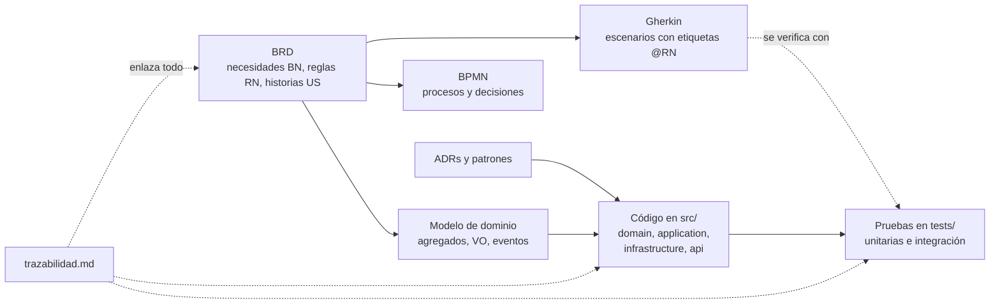

# Arquitectura de FitZone

Índice de la documentación de arquitectura del PIA (Equipo 11, FIME-UANL). Todo lo que aquí se describe corresponde al código de `src/`; lo que se diseñó pero no se programó está marcado como tal.

| Documento | Qué responde |
|---|---|
| [modelo-dominio.md](modelo-dominio.md) | Entidades, Value Objects, agregado, eventos y servicios; diagrama de clases del código y diagrama por capas |
| [ciclos-de-vida.md](ciclos-de-vida.md) | Máquinas de estado (las de membresía y reserva están implementadas) y secuencia de los casos de uso principales |
| [patrones.md](patrones.md) | Patrones elegidos, dónde están en el código y por qué |
| [solid.md](solid.md) | Evidencia de cada principio SOLID en el código y hallazgos pendientes |
| [adr/](adr/README.md) | Decisiones de arquitectura (contexto, decisión, alternativas, consecuencias) |
| [decisiones-tecnicas.md](decisiones-tecnicas.md) | Stack, configuración, contenedores, CI/CD y despliegue |
| [diferencias-paquete-pia.md](diferencias-paquete-pia.md) | Cómo se traduce el paquete de datos del PIA al dominio de FitZone |
| [trazabilidad.md](trazabilidad.md) | Matriz BRD → regla → componente → prueba |

## Alcance implementado

El BRD describe todo el negocio de FitZone (membresías, reservas, lista de espera, no-shows, cancelación de clases, excepciones y reportes). El código implementa dos módulos: la **contratación de membresías** (BN-09 y BN-10, RN-37 a RN-41, junto con RN-03, RN-08, RN-09 y RN-10), que es el que usa el paquete de datos del profesor, y **clases, reservas, lista de espera y sanciones** (BN-01 y BN-02, RN-05, RN-11, RN-13 a RN-28). Las demás reglas están analizadas y diseñadas (BRD, BPMN y Actividad 3) pero no programadas; la [matriz de trazabilidad](trazabilidad.md) dice cuál es cuál y [ADR-008](adr/ADR-008-alcance-del-codigo.md) justifica el corte.

## Cómo se relacionan los artefactos

