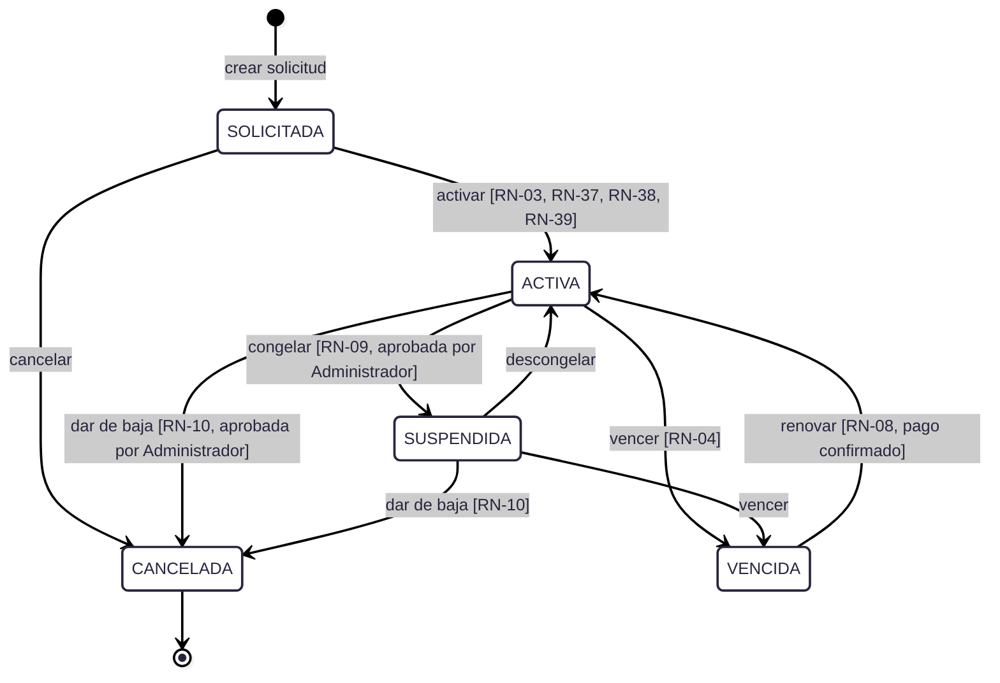
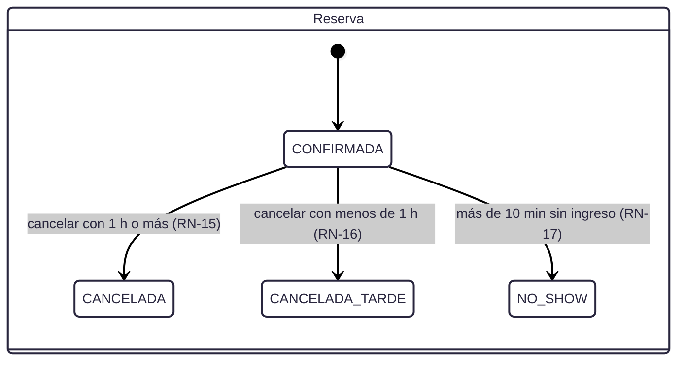
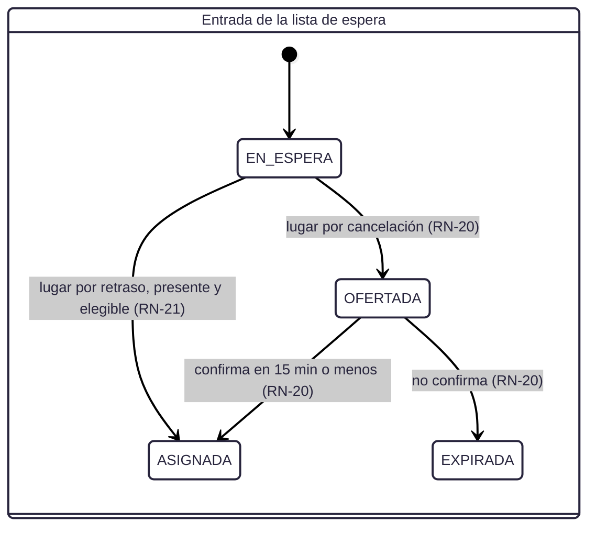
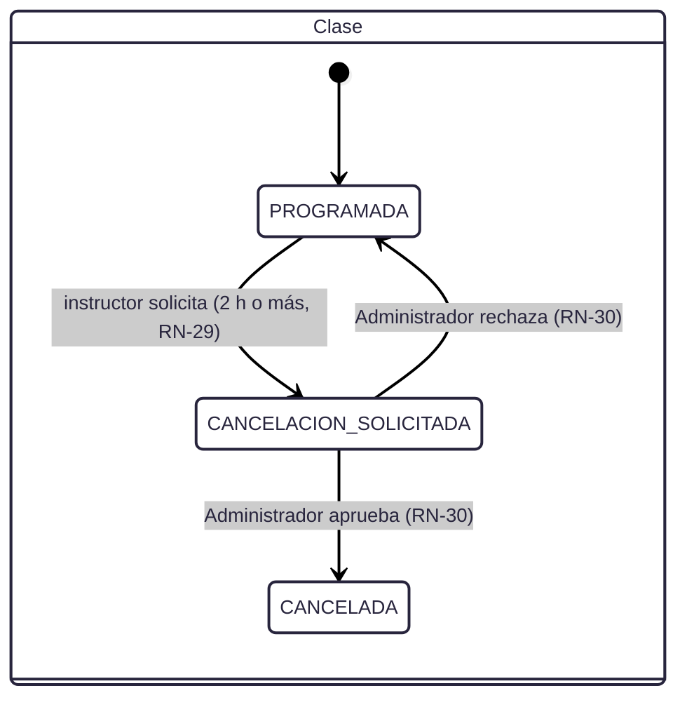
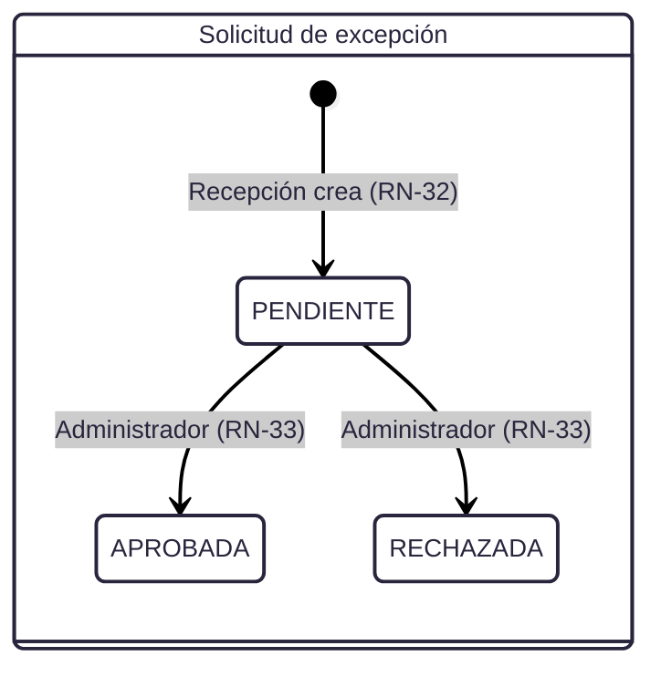
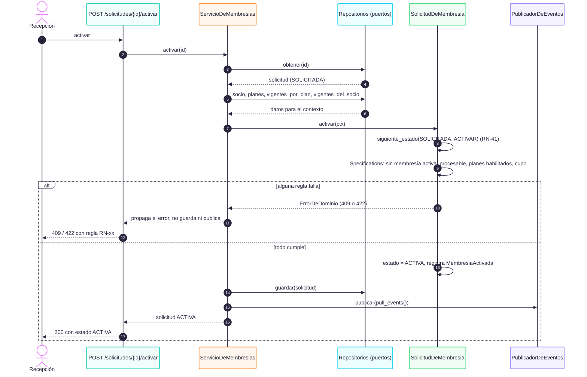
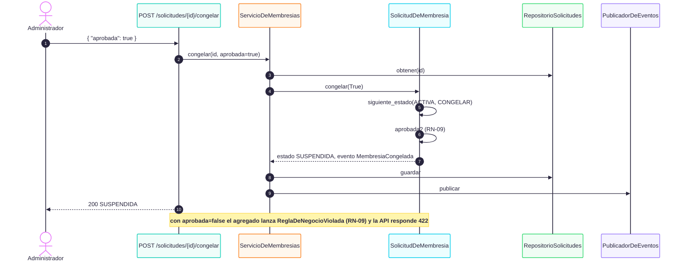
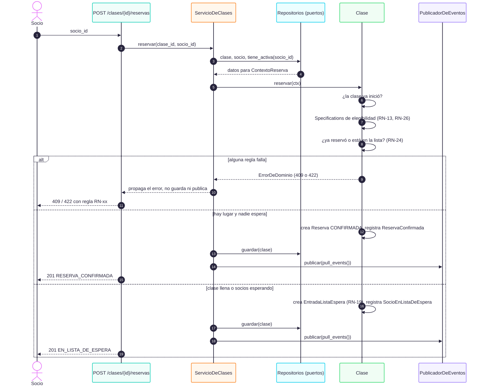
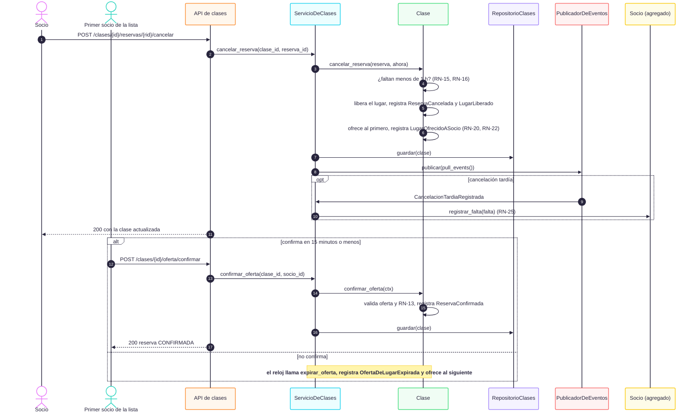
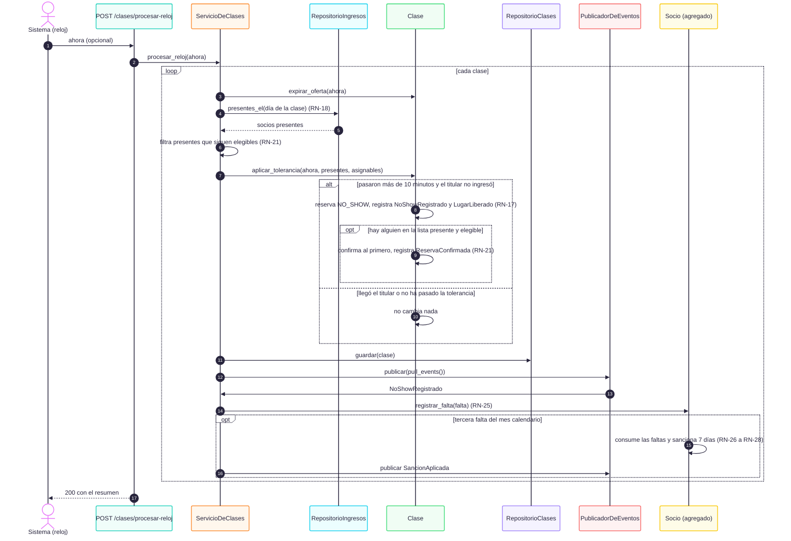

# Ciclos de vida y secuencias

## 1. Membresía / solicitud de membresía (implementado)

Es la tabla `TRANSICIONES` de `src/domain/state_machine.py` (RN-41). Cualquier par estado-acción que no esté en la tabla se rechaza con 409.

| Desde | Acción | Hacia | Evento |
|---|---|---|---|
| SOLICITADA | activar | ACTIVA | `MembresiaActivada` |
| SOLICITADA | cancelar | CANCELADA | `SolicitudCancelada` |
| ACTIVA | congelar | SUSPENDIDA | `MembresiaCongelada` |
| SUSPENDIDA | descongelar | ACTIVA | `MembresiaDescongelada` |
| ACTIVA, SUSPENDIDA | vencer | VENCIDA | `MembresiaVencida` |
| VENCIDA | renovar | ACTIVA | `MembresiaRenovada` |
| ACTIVA, SUSPENDIDA | dar de baja | CANCELADA | `MembresiaDadaDeBaja` |

Reglas del ciclo:
- **CANCELADA es final**: no sale ninguna acción.
- **Saltar un estado** (por ejemplo vencer una SOLICITADA) o **repetir una aprobación** devuelve 409 con `regla: RN-41`.
- **Falta una autorización o un pago** (congelar y dar de baja sin aprobación, renovar sin pago): primero se valida la transición (409) y después la regla (422, RN-09, RN-10 o RN-08).
- **El estado no cambia si el dominio rechaza**: el servicio no guarda ni publica nada.

> La Actividad 3 llamaba a este concepto `Membresía` con `afiliarSocio`. En el código la entidad que atraviesa el ciclo es la solicitud (ver [diferencias-paquete-pia.md](diferencias-paquete-pia.md)).

## 2. Reserva y lista de espera (implementado)

Es la tabla `TRANSICIONES_RESERVA` de `src/domain/state_machine.py`.

Decisiones que el BRD no fija y que el código resuelve así:
- **Membresía vigente** es tener una membresía en estado `ACTIVA`. El código no guarda fecha de vencimiento (RN-04 sigue parcial); una `SUSPENDIDA` no reserva ni ingresa.
- **Clase iniciada:** ya no se reserva ni se cancela (409). Tampoco se hacen ofertas nuevas: desde ese momento los lugares solo se asignan por RN-21.
- **Lugar ofrecido:** sigue apartado hasta que la oferta se resuelva, y quien reserva con socios esperando entra a la lista, aunque quede un lugar libre (RN-19).
- **Confirmar una oferta** vuelve a exigir RN-13: si el socio perdió la elegibilidad se rechaza (422) y la oferta sigue hasta expirar.
- **Orden de validación** (BPMN 12.2): clase iniciada (409), elegibilidad (422), reserva o lista repetida (409, RN-24).
- **Fecha de la falta:** es la hora de inicio de la clase, para que el mes calendario (RN-26) no dependa de cuándo corra el reloj.
- **Sanción activa:** las faltas nuevas se acumulan sin extenderla (RN-28) y cuentan para la siguiente sanción si son del mismo mes.

## 3. Otros ciclos del BRD (diseñados, no programados)

Una excepción ya resuelta no se resuelve dos veces (RN-33, 409). En el código, la aprobación del Administrador llega como el campo `aprobada` de `congelar` y `dar-de-baja`; el agregado `SolicitudExcepcion` completo no se programó.

## 4. Secuencia: activar una solicitud

## 5. Secuencia: congelar con aprobación del Administrador

## 6. Secuencia: reservar una clase

## 7. Secuencia: cancelar y ofrecer el lugar

## 8. Secuencia: tolerancia, no-show y sanción

