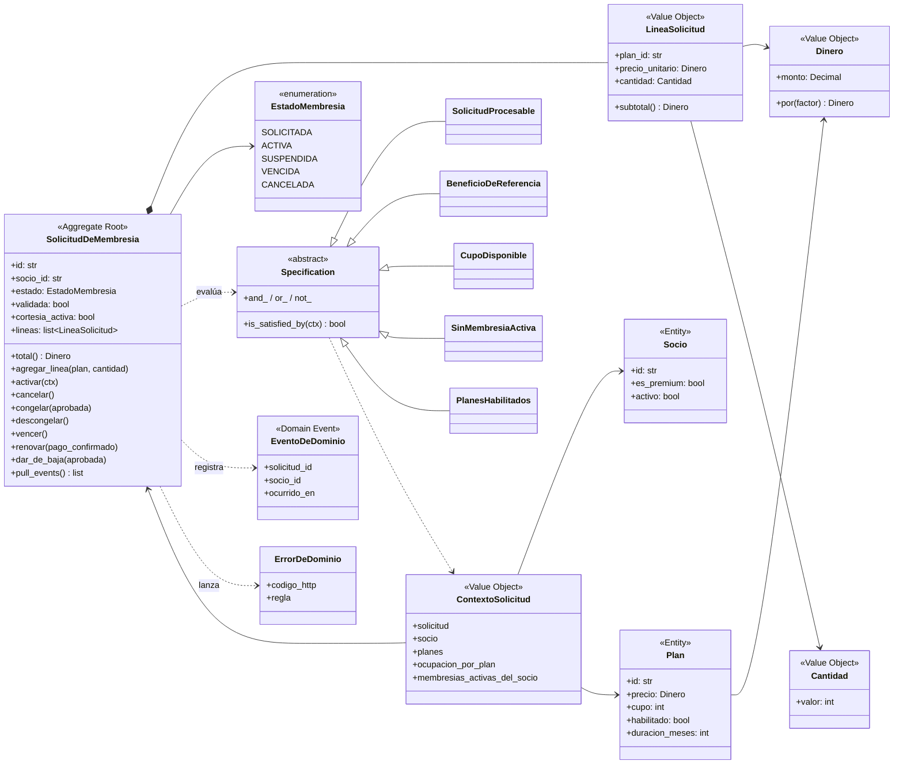
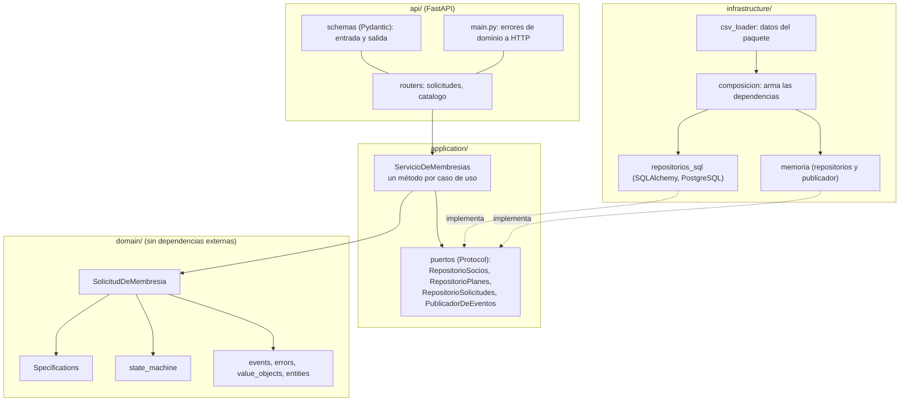
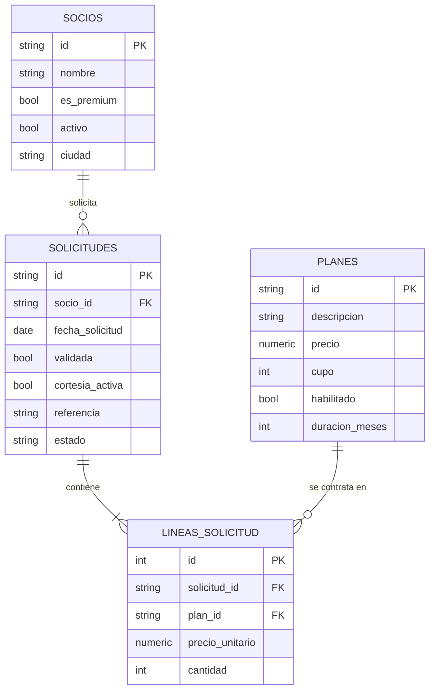

# Modelo de dominio

El modelo se diseñó para todo FitZone en la Actividad 3 y se refinó para el PIA. Esta página separa lo que **está en el código** de lo que **solo está diseñado**.

## 1. Mapa de dominio

| Elemento | Diseñado (Act3 y BRD) | En el código (`src/domain/`) |
|---|---|---|
| Aggregates | Socio, Membresía, Plan, Clase, Instructor, Empleado, SolicitudExcepción | **SolicitudDeMembresia** (`solicitud.py`), **Clase** (`clase.py`), **Socio** (`entities.py`) |
| Entidades | Socio, Membresía, Plan, Clase, Reserva, EntradaListaEspera, Instructor, Empleado, SolicitudExcepción | **Plan** (`entities.py`), **Reserva**, **EntradaListaEspera** (`clase.py`) |
| Value Objects | NumeroSocio, DatosContacto, FechaNacimiento, Deslinde, Falta, Sanción, PeriodoVigencia, SaldoAFavor, Capacidad, Horario, EstadoReserva, PlazoConfirmacion, Rol, TipoExcepcion, EstadoClase | **Dinero**, **Cantidad**, **LineaSolicitud**, **Falta** (`value_objects.py`) |
| Domain Services | ElegibilidadDeReserva, CalculoDeCambioDePlan | Las Specifications cumplen el papel de validar entre agregados (`specifications.py`) |
| Domain Events | 22 eventos (13 con suscriptor automático), BRD sección 13 | 7 eventos de la membresía y 10 de reservas y sanciones (`events.py`) |
| Máquina de estados | Membresía, Reserva, Clase, SolicitudExcepción | **Membresía** y **Reserva** (`state_machine.py`); los demás ciclos están en [ciclos-de-vida.md](ciclos-de-vida.md) |

Lo que el sistema comunica (push y correo) no es un agregado: reacciona a los eventos de dominio (RN-34).

### Correspondencia con el paquete del profesor (Anexo B del BRD)

| Paquete | Dominio FitZone |
|---|---|
| actor | Socio (`es_preferente` = Premium) |
| recurso | Plan de membresía (`capacidad_o_stock` = cupo de contratación) |
| operación | Solicitud de membresía (`autorizado` = validada, `promocion_activa` = cortesía) |
| estados | SOLICITADA, ACTIVA, SUSPENDIDA, VENCIDA, CANCELADA |

### Clases y reservas

`Clase` es el agregado que protege la capacidad (RN-11) y el orden de la lista (RN-19). `Socio` registra sus faltas y su sanción y se entera por los eventos `NoShowRegistrado` y `CancelacionTardiaRegistrada` (ADR-003). Las Specifications `MembresiaVigente`, `PlanIncluyeCategoria` y `SinSancionActiva` se combinan en `ElegibleParaReservar` (RN-13). El dominio recibe `ahora` como dato; el puerto `Reloj` lo provee la capa de aplicación.

## 2. Diagrama de clases del código

El diagrama muestra el módulo de membresías.

El agregado `SolicitudDeMembresia` es la única puerta para cambiar el estado: toda acción pasa por `siguiente_estado()` (RN-41) y cada cambio registra un evento que la capa de aplicación publica después de guardar.

### Domain Events implementados

| Evento | Lo emite | Regla |
|---|---|---|
| `MembresiaActivada` | `activar()` | RN-37, RN-38, RN-03, RN-39 |
| `MembresiaCongelada` | `congelar()` | RN-09 |
| `MembresiaDescongelada` | `descongelar()` | RN-41 |
| `MembresiaVencida` | `vencer()` | RN-04 |
| `MembresiaRenovada` | `renovar()` | RN-08 |
| `MembresiaDadaDeBaja` | `dar_de_baja()` | RN-10 |
| `SolicitudCancelada` | `cancelar()` | RN-41 |

## 3. Arquitectura por capas

Las dependencias apuntan hacia el dominio: `domain` no importa nada de las otras capas, `application` solo conoce el dominio y los puertos, y `infrastructure` implementa esos puertos. Con `DATABASE_URL` se usa PostgreSQL; sin ella, memoria (ver [ADR-006](adr/ADR-006-puertos-y-adaptadores.md)).

## 4. Modelo de datos (PostgreSQL)

El `precio_unitario` se guarda en la línea: el total de una solicitud no cambia si el plan cambia de precio después (RN-38).
